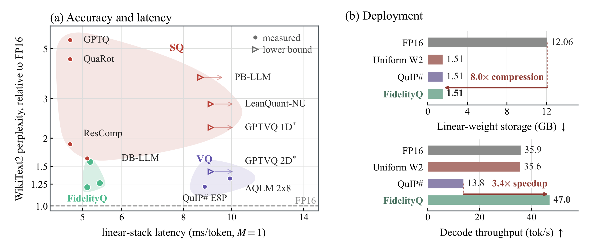
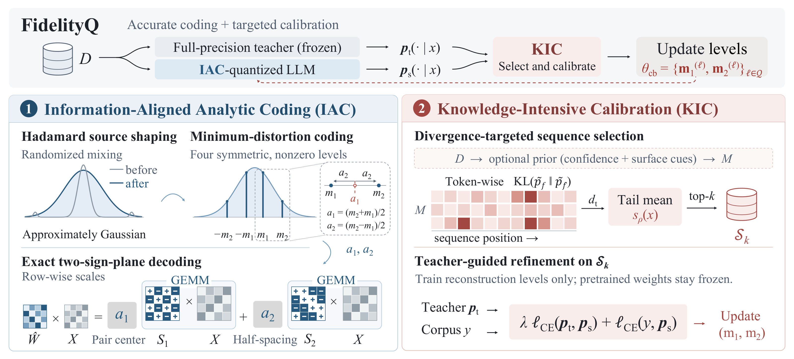

# FidelityQ: Preserving Predictive Fidelity in Ultra-Low-Bit Language Model Quantization

**[Paper](https://arxiv.org/abs/2610.14934) | [Code (coming soon)](#code-and-models) | [Models (coming soon)](#code-and-models)**

Yujie Chen<sup>1</sup>, Weiyan Zheng<sup>2</sup>, Yiwu Yao<sup>2</sup>, Tianchi Hu<sup>2</sup>, Bo Wang<sup>2</sup>, Jiyu Guo<sup>3</sup>, Wenzhan Li<sup>4</sup>, Jingcai Guo<sup>1</sup>, Michele Magno<sup>5</sup>, Haotong Qin<sup>1,†</sup>

<sup>1</sup>The Hong Kong Polytechnic University &nbsp; <sup>2</sup>Huawei Technologies Ltd. &nbsp; <sup>3</sup>The University of Hong Kong &nbsp; <sup>4</sup>Sun Yat-sen University &nbsp; <sup>5</sup>ETH Zurich
<br><sup>†</sup>Corresponding author: haotong.qin@polyu.edu.hk

**2-bit scalar weight quantization for LLMs** that approaches codebook-level accuracy at scalar decoding cost. On LLaMA-2-7B it reaches a WikiText2 perplexity of 6.62 at W2A16 and 6.96 at W2A4KV4.



## News

- [2026/10] 🔥 The paper is available on [arXiv](https://arxiv.org/abs/2610.14934). Code and quantized checkpoints will be released in the coming days.

## Abstract

Ultra-low-bit scalar quantization offers a regular arithmetic structure for efficient deployment of large language models, but preserving their predictive behavior at extreme precision remains challenging. With only a few reconstruction levels, accurate weight representation must translate into consistent model predictions using a small set of calibration samples. We propose **FidelityQ**, a scalar quantization framework for preserving predictive fidelity at weight precisions down to 2 bits. Specifically, we introduce *Information-Aligned Analytic Coding* (**IAC**) for accurate quantization. IAC shapes each weight row toward a centered symmetric source through randomized Hadamard mixing, then fits a mirrored four-level minimum-distortion quantizer to its empirical weights. Every level set in this symmetry-aligned family decomposes exactly into 2 sign-valued bases with associated scales, combining source-adaptive reconstruction with lookup-free decoding compatible with scaled integer arithmetic. Our analysis further reveals that residual predictive discrepancies are heavy-tailed and concentrate on tokens that the teacher predicts confidently, motivating *Knowledge-Intensive Calibration* (**KIC**) for consistent quantization. KIC ranks sequences using the tail of token-wise teacher-student divergence and allocates a limited calibration budget to the highest-scoring samples. It then restores predictive agreement by updating only per-row reconstruction levels under teacher supervision, leaving the pretrained weights frozen. Experiments on the LLaMA and Qwen families demonstrate the effectiveness of FidelityQ across weight-only and joint quantization settings. On LLaMA-2-7B, FidelityQ achieves a WikiText2 perplexity of 6.62 at W2A16 and improves the prior state-of-the-art W2A4KV4 result from 8.31 to 6.96, while reducing linear-layer weight memory by 8.0× relative to FP16.

## Overview



FidelityQ has two stages. Both work on the same per-row reconstruction levels.

- **Information-Aligned Analytic Coding (IAC).** A randomized Hadamard transform reshapes each weight row toward a centered, near-Gaussian source. IAC then fits four mirrored levels `{±m1, ±m2}` per row by minimum-distortion (Lloyd-Max) coding. Every such level set decomposes exactly into two sign planes with row-wise scales, `Ŵ = a1·S1 + a2·S2`, so a 2-bit linear layer runs as two scaled GEMMs on ±1 matrices, with no lookup table.
- **Knowledge-Intensive Calibration (KIC).** KIC scores each candidate sequence by the mean of its largest token-wise divergences between the full-precision teacher and the IAC-quantized model. It keeps the top-*k* sequences, then trains only the reconstruction levels with hard CE plus teacher soft-target CE. The pretrained weights and the code assignments stay frozen.

## Results

WikiText2 and C4 perplexity at context length 2048. Avg-7 is the mean accuracy over ARC-Easy, ARC-Challenge, HellaSwag, PIQA, WinoGrande, BoolQ and OpenBookQA. MMLU is 5-shot. W-A-KV gives the bit widths of weights, activations and KV cache. Full per-task results are in the paper.

**LLaMA-2-7B**

| Method | W-A-KV | Wiki2 ↓ | C4 ↓ | Avg-7 ↑ | MMLU ↑ |
|---|---|---|---|---|---|
| FP16 | 16-16-16 | 5.47 | 6.97 | 66.67 | 45.94 |
| AQLM\* | 2-16-16 | 7.24 | 8.96 | 58.04 | 33.03 |
| QuaRot | 2-16-16 | 24.52 | 39.39 | 42.45 | 25.87 |
| DB-LLM | 2-16-16 | 8.89 | 19.85 | 47.80 | 24.95 |
| ResComp | 2-16-16 | 10.28 | 19.68 | 47.70 | 27.17 |
| **FidelityQ** | 2-16-16 | **6.62** | 9.53 | **59.63** | **37.29** |
| QuaRot | 2-4-4 | 47.23 | 77.49 | 39.06 | 24.92 |
| ResComp | 2-4-4 | 12.78 | 23.91 | 44.81 | 26.01 |
| **FidelityQ** | 2-4-4 | **6.96** | **9.97** | **57.25** | **33.99** |

**LLaMA-2-13B**

| Method | W-A-KV | Wiki2 ↓ | C4 ↓ | Avg-7 ↑ | MMLU ↑ |
|---|---|---|---|---|---|
| FP16 | 16-16-16 | 4.88 | 6.47 | 69.27 | 55.43 |
| AQLM\* | 2-16-16 | 6.06 | 7.80 | 63.25 | 45.38 |
| DB-LLM | 2-16-16 | 7.97 | 17.61 | 53.75 | 26.62 |
| ResComp | 2-16-16 | 7.90 | 14.05 | 52.46 | 27.97 |
| **FidelityQ** | 2-16-16 | **5.86** | 8.43 | **63.97** | **45.54** |
| ResComp | 2-4-4 | 9.70 | 19.10 | 47.88 | 27.19 |
| **FidelityQ** | 2-4-4 | **6.04** | **8.81** | **62.14** | **43.74** |

**Qwen3-8B-Base and LLaMA-30B**

| Model | Method | W-A-KV | Wiki2 ↓ | C4 ↓ | Avg-7 ↑ | MMLU ↑ |
|---|---|---|---|---|---|---|
| Qwen3-8B-Base | FP16 | 16-16-16 | 7.00 | 10.42 | 70.18 | 76.84 |
| | ResComp | 2-16-16 | 11.21 | 22.82 | 51.56 | 36.06 |
| | **FidelityQ** | 2-16-16 | **8.84** | **13.64** | **63.85** | **59.94** |
| | ResComp | 2-4-4 | 14.85 | 31.40 | 47.65 | 30.86 |
| | **FidelityQ** | 2-4-4 | **10.69** | **16.59** | **59.17** | **47.60** |
| LLaMA-30B | FP16 | 16-16-16 | 4.10 | 5.98 | 72.36 | 58.30 |
| | ResComp | 2-16-16 | 6.45 | 10.38 | 60.06 | 32.00 |
| | **FidelityQ** | 2-16-16 | **5.14** | **7.64** | **67.06** | **49.96** |
| | ResComp | 2-4-4 | 6.88 | 11.14 | 56.62 | 29.67 |
| | **FidelityQ** | 2-4-4 | **5.71** | **7.79** | **65.31** | **38.64** |

\* AQLM is a codebook method with lookup decoding; the other baselines are scalar methods.

**Efficiency.** On LLaMA-2-7B at batch size 1 (RTX A6000):

- Linear-layer weights take 1.51 GB, 8.0× less than FP16.
- The linear stack takes 5.1 ms per token, against 9.9 ms for AQLM.
- The full model decodes 47.0 tokens/s in eager mode, against 35.9 for FP16 and 13.8 for QuIP#.

## Code and Models

Coming soon. The release will include:

- [ ] IAC quantization pipeline (Hadamard rotation, per-row mirrored levels, GPTAQ-style compensation)
- [ ] KIC sequence selection and level-only calibration
- [ ] Evaluation scripts (perplexity, lm-evaluation-harness)
- [ ] Quantized checkpoints

## Citation

If you find FidelityQ useful, please cite:

```bibtex
@article{chen2026fidelityq,
  title   = {FidelityQ: Preserving Predictive Fidelity in Ultra-Low-Bit Language Model Quantization},
  author  = {Chen, Yujie and Zheng, Weiyan and Yao, Yiwu and Hu, Tianchi and Wang, Bo and Guo, Jiyu and Li, Wenzhan and Guo, Jingcai and Magno, Michele and Qin, Haotong},
  journal = {arXiv preprint arXiv:2610.14934},
  year    = {2026}
}
```

## Acknowledgements

FidelityQ builds on [QuaRot](https://github.com/spcl/QuaRot), [GPTQ](https://github.com/IST-DASLab/gptq), [GPTAQ](https://github.com/Intelligent-Computing-Lab-Panda/GPTAQ) and [ResComp](https://github.com/list0830/ResComp).
